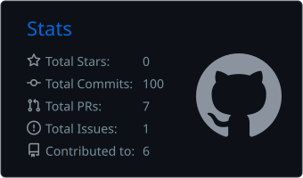
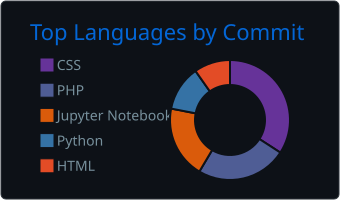

<div align="center">
  
</div>

<p align="center">
  <a href="https://git.io/typing-svg">
    
  </a>
</p>

<p align="center">
  <a href="https://www.linkedin.com/in/gokulnath-prabaharan-1a95b4171/"></a>
  <a href="mailto:gokupraba214@gmail.com"></a>
  <a href="https://github.com/gokupraba214?tab=followers"></a>
  
</p>


## 🚀 About Me

<table>
<tr>
<td width="62%" valign="top">

```javascript
const gokulnath = {
    pronouns: "He" | "Him",
    location: "🌍 Based in Malaysia",
    education: "🎓 Software Engineering Student",
    experience: "3+ years in IT Operations & Support",

    technologies: {
        frontEnd: ["React", "Next.js", "HTML5", "CSS3"],
        backEnd: ["Node.js", "Java", "REST APIs"],
        databases: ["MySQL", "Firebase"],
        tools: ["Git", "VS Code", "Vercel", "Render"],
        cloud: ["AWS", "Cloud Computing"],
        currentlyLearning: [
            "AWS re/Start",
            "Google Cybersecurity",
            "Docker",
            "Cloud Computing"
        ]
    },

    funFact: "I debug in my sleep! 😴💻"
};
```

</td>
<td width="38%" valign="top">

### ⚡ Quick Snapshot

- 🛠️ **3+ years** in IT Operations & Support
- 🎓 Software Engineering Student
- ☁️ Heading towards **Cloud & Software Engineer**
- 🔐 Building **Cybersecurity** fundamentals
- 🌍 Based in **Malaysia**

### 📚 Currently Learning

<p>
  
  
  
  
</p>

</td>
</tr>
</table>


## 🛠️ Tech Stack & Tools

<div align="center">

<table>
<tr>
<td align="center" width="160"><b>👨‍💻 Languages</b></td>
<td>


</td>
</tr>
<tr>
<td align="center"><b>🚀 Frameworks & Libraries</b></td>
<td>


</td>
</tr>
<tr>
<td align="center"><b>🗄️ Databases</b></td>
<td>


</td>
</tr>
<tr>
<td align="center"><b>☁️ Cloud & Hosting</b></td>
<td>


</td>
</tr>
<tr>
<td align="center"><b>🛠️ Tools & Platforms</b></td>
<td>


</td>
</tr>
</table>

<br/>


</div>


## 🎯 Current Goals

- ☁️ Exploring **Cloud Computing and Software Engineering**
- 🚀 Participating in the **AWS re/Start program**
- 🔐 Learning through the **Google Cybersecurity program**
- 💬 Ask me about **IT troubleshooting**
- ⚡ Fun fact: **I can troubleshoot systems faster than I can order coffee!** ☕


## 📈 GitHub Activity

<div align="center">
  
  
</div>

<br/>

<div align="center">
  
</div>

<br/>

<div align="center">
  <picture>
    <source media="(prefers-color-scheme: dark)" srcset="https://raw.githubusercontent.com/gokupraba214/gokupraba214/output/github-contribution-grid-snake-dark.svg" />
    <source media="(prefers-color-scheme: light)" srcset="https://raw.githubusercontent.com/gokupraba214/gokupraba214/output/github-contribution-grid-snake.svg" />
    
  </picture>
</div>


## 📫 Let's Connect

<div align="center">

<p align="center">
  <a href="https://www.linkedin.com/in/gokulnath-prabaharan-1a95b4171/"></a>
  <a href="mailto:gokupraba214@gmail.com"></a>
  <a href="https://github.com/gokupraba214"></a>
</p>

<h3>💖 Support My Work</h3>
<p>If you find my work helpful, consider buying me a coffee! ☕</p>

<a href="https://paypal.me/GOKULNATHPRABAHARAN"></a>

<br/><br/>

<b>Show some ❤️ by starring ⭐ some repositories!</b>

</div>


